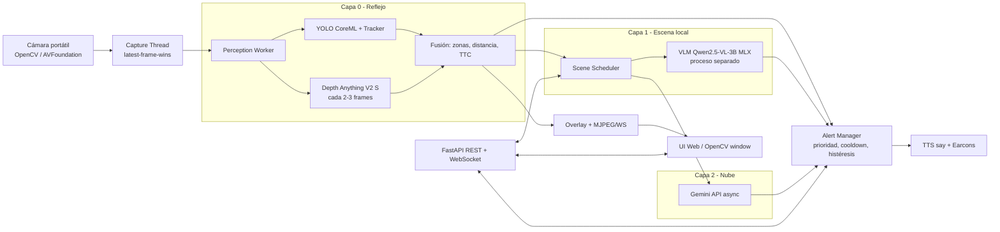

# Sistema de Visión Asistiva para Personas Invidentes
**Arquitectura y especificaciones técnicas** · FastAPI · YOLO · VLM local · Gemini · macOS (MacBook Air M4, 16 GB)

---

## 1. Resumen

Sistema que captura video de la cámara del portátil en tiempo real, detecta obstáculos y objetos relevantes (personas, vehículos, escalones, huecos, puertas, calles), los dibuja sobre el video y **avisa por audio** con frases cortas y direccionales. Además ofrece **descripción de escena** bajo demanda o periódica mediante un VLM local y Gemini (API).

### Objetivos de diseño
| Objetivo | Meta |
|---|---|
| Latencia alerta crítica (frame → audio iniciando) | **< 250 ms** |
| FPS de percepción | **≥ 15 FPS** sostenidos |
| Descripción de escena local (VLM) | 1–3 s |
| Descripción de escena Gemini | 1–3 s (depende de red) |
| Memoria total en uso | **< 8 GB** (margen para macOS y navegador) |
| Operación sin internet | Sí (capa reflejo + VLM local); Gemini es opcional |

### Principio central: **3 capas por latencia**

| Capa | Función | Tecnología | Latencia | Frecuencia |
|---|---|---|---|---|
| **L0 – Reflejo** | Obstáculos, personas, vehículos, huecos → alerta inmediata | YOLO + profundidad + reglas | 30–100 ms | cada frame |
| **L1 – Escena local** | Descripción en lenguaje natural sin internet | VLM local (MLX) | 1–3 s | bajo demanda / al cambiar la escena |
| **L2 – Escena nube** | Descripción rica, lectura de texto/carteles, preguntas | Gemini API | 1–3 s + red | bajo demanda / fallback |

> **Regla clave:** las alertas de seguridad **nunca** dependen de un VLM ni de la nube. Solo L0 puede interrumpir el audio.

---

## 2. Aviso de seguridad (obligatorio en el producto)

Este sistema es una **ayuda complementaria**, no reemplaza el bastón, el perro guía ni la orientación y movilidad entrenada. Los modelos de visión fallan (oclusión, poca luz, reflejos, objetos no vistos en entrenamiento, huecos/desniveles en particular). Se recomienda:
- Mostrar y verbalizar un aviso al iniciar.
- Validar con usuarios invidentes y especialistas en orientación y movilidad antes de cualquier uso real.
- Registrar métricas de falsos negativos por clase (ver §14).

---

## 3. Evaluación de opciones

### 3.1 Detección de objetos (capa reflejo)

| Opción | Pros | Contras | Veredicto |
|---|---|---|---|
| **YOLO11n / YOLO11s** (Ultralytics) | Muy rápido, export CoreML, tracking integrado (ByteTrack/BoT-SORT), ecosistema maduro | Licencia AGPL-3.0 (revisar si se comercializa) | ✅ **Recomendado** |
| **YOLO26n** (Ultralytics, si está disponible en tu versión) | Diseñado para edge, sin NMS, menor latencia en CPU | Más reciente, menos documentación | ✅ Probar en benchmark |
| **RF-DETR / RT-DETR** | Muy buena precisión, licencias más permisivas (RF-DETR) | Más pesado que YOLO-n en M4 | 🟡 Alternativa si licencia es problema |
| **YOLO-World** (vocabulario abierto) | Detecta "hueco", "escalón", "poste" con texto | Menos preciso y más lento | 🟡 Opcional como L1.5 |
| **MediaPipe Object Detector** | Liviano, licencia Apache | Menos clases/precisión | 🟡 Plan B |

**Decisión:** `yolo11n` (o `yolo26n`) exportado a **CoreML** (usa Neural Engine/GPU) a 640 px, con tracking activado. Subir a `s` si el benchmark lo permite (§14).

> COCO (80 clases) no incluye huecos, escalones ni bordillos. Por eso se complementa con **profundidad** (§3.2) y, a mediano plazo, un fine-tuning con dataset propio de obstáculos urbanos.

### 3.2 Profundidad / distancia (clave para obstáculos y huecos)

| Opción | Notas |
|---|---|
| **Depth Anything V2 Small** (CoreML/MPS) | Profundidad densa relativa por frame; versión *metric* (indoor/outdoor) da metros aproximados. ✅ Recomendado |
| Heurística por tamaño de bbox | Gratis; sirve como respaldo y para validar (altura de persona ≈ 1.7 m) |
| MiDaS small | Alternativa más antigua |

**Decisión:** Depth Anything V2 Small ejecutado cada 2–3 frames + heurística de bbox por frame. La profundidad se usa para: (a) distancia de objetos detectados, (b) detectar **obstáculos sin clase** (algo cerca en la zona de caminata aunque YOLO no lo reconozca), (c) detectar **discontinuidades de suelo** (posibles huecos/escalones, marcado como *experimental*).

### 3.3 VLM local (L1)

| Modelo | RAM aprox. (4-bit) | Notas |
|---|---|---|
| **Qwen2.5-VL-3B-Instruct** (MLX) | 2.5–3.5 GB | Mejor español y razonamiento espacial ✅ |
| **SmolVLM2-2.2B** (MLX) | ~2 GB | Más rápido, descripciones más simples |
| **Moondream2** | ~1.5 GB | Muy liviano, calidad limitada |

**Decisión:** Qwen2.5-VL-3B 4-bit con `mlx-vlm`, imagen reducida a ~448–640 px por el lado largo para mantener 1–3 s. Se ejecuta en **proceso separado** para no bloquear el reflejo.

### 3.4 Gemini (L2)

- SDK: `google-genai`. Modelo configurable por variable de entorno (`GEMINI_MODEL`), por defecto un modelo **Flash / Flash-Lite** vigente (equilibrio latencia/costo).
- Se envía JPEG reducido (≈ 640 px, calidad 70) + las detecciones L0 como contexto textual para que describa de forma consistente con lo que el sistema ya sabe.
- Usar **streaming** (`generate_content_stream`) y empezar a hablar por frases completas para reducir la latencia percibida.
- Timeout corto (4 s) y **fallback automático al VLM local**.

### 3.5 Audio

| Opción | Latencia | Notas |
|---|---|---|
| **`say` de macOS** (subproceso) | ~50–100 ms | Sin dependencias, voces es-CO (**Soledad**, **Carlos**) – verificar con `say -v '?'` ✅ |
| `AVSpeechSynthesizer` vía `pyobjc` | ~50 ms | Más control, más complejo |
| Web Speech API (navegador) | ~0 ms servidor | Útil si la UI corre en el navegador/móvil |
| **Earcons** (tonos) con `sounddevice` | < 20 ms | Pitidos con paneo estéreo: más rápidos que la voz para peligro inmediato ✅ |

**Decisión:** voz con `say` (interrumpible) + **earcons espaciales** (tono más agudo/frecuente = más cerca; paneo izquierda/derecha = dirección).

---

## 4. Arquitectura general



### 4.1 Modelo de concurrencia (clave para baja latencia)

| Componente | Mecanismo | Razón |
|---|---|---|
| Captura de cámara | Hilo dedicado, buffer de 1 frame ("latest wins") | Evita acumulación de frames viejos |
| Percepción (YOLO + depth) | Hilo/executor dedicado (CoreML libera el GIL) | No bloquea el event loop |
| VLM local | **Proceso separado** (`multiprocessing`, cola de tamaño 1) | Aísla memoria/GPU y evita bloquear L0 |
| Gemini | `asyncio` (`httpx`/SDK async) con timeout | I/O de red |
| TTS | Subproceso `say`; se mata al llegar alerta de mayor prioridad | Interrupción inmediata |
| API/WebSocket | Uvicorn (1 worker) + asyncio | Estado compartido en memoria |

> Usar **1 solo worker de Uvicorn**: la cámara y los modelos son estado compartido.

### 4.2 Política de frames
- Cola de tamaño 1: si la inferencia va lenta, se **descartan** frames antiguos (jamás acumular).
- YOLO: cada frame (o cada 2 si FPS < 15).
- Profundidad: cada 2–3 frames, interpolando en medio con el tracker.
- VLM/Gemini: solo frames "estables" (poco movimiento) y solo cuando el scheduler lo pide.

---

## 5. Presupuesto de latencia y memoria (estimado – validar con benchmark)

| Etapa | Tiempo estimado en M4 |
|---|---|
| Captura + resize | 5–10 ms |
| YOLO11n CoreML 640 px | 6–15 ms |
| Tracking | 1–3 ms |
| Depth Anything V2 S (cada 2–3 frames) | 25–60 ms |
| Fusión + reglas | 2–5 ms |
| Dibujo overlay + codificación MJPEG | 5–10 ms |
| Inicio de audio (`say` / earcon) | 20–100 ms |
| **Total reflejo (percepción → audio)** | **~80–200 ms** |

| Recurso | RAM aprox. |
|---|---|
| YOLO11n/s | 0.1–0.3 GB |
| Depth Anything V2 S | 0.2–0.5 GB |
| VLM Qwen2.5-VL-3B 4-bit | 2.5–3.5 GB |
| FastAPI + OpenCV + buffers | ~1 GB |
| **Total** | **~4–5.5 GB** (cabe holgado en 16 GB) |

---

## 6. Percepción: de píxeles a "lo que importa"

### 6.1 Zonas de interés
Dividir el frame en una cuadrícula de **3 columnas × 3 filas** (o 5 sectores horizontales):

```
 izquierda | centro | derecha      ← dirección (clock: 10-11 / 12 / 1-2)
 ----------+--------+----------
  lejos    (fila superior)
  medio    (fila media)
  cerca    (fila inferior = suelo frente al usuario)   ← zona crítica de caminata
```

- **Corredor de caminata:** trapecio central inferior (≈ 40 % del ancho en la base). Todo lo que entra aquí y está a < 3 m es candidato a alerta.

### 6.2 Distancia
1. Profundidad metric (si disponible) en el centro de la bbox (mediana de un parche, no el píxel central).
2. Respaldo: `distancia ≈ (altura_real_clase × focal_px) / alto_bbox_px` con alturas de referencia por clase (persona 1.7 m, puerta 2.0 m, silla 0.9 m…). Calibrar `focal_px` una vez con la cámara del portátil.
3. Suavizado con filtro de Kalman o EMA por `track_id`.

### 6.3 Tiempo a colisión (TTC) y velocidad de aproximación
Por `track_id`: `v = Δdistancia / Δt` (EMA). `TTC = distancia / v` si `v > 0`. Un vehículo o persona acercándose rápido sube de prioridad aunque esté a 5 m.

### 6.4 Obstáculos sin clase y huecos (experimental)
- **Obstáculo genérico:** en el corredor, si la profundidad media de una región es significativamente menor que la del suelo esperado y YOLO no detecta nada → "Obstáculo adelante".
- **Hueco / desnivel:** analizar la franja inferior central: una **discontinuidad brusca** de profundidad (el suelo "se aleja" de golpe) respecto a la línea base del suelo → "Posible desnivel o hueco adelante". Marcar como *baja confianza*, exigir persistencia de ≥ 3 frames.
- **Calle / calzada:** modelo de segmentación ligero (`yolo11n-seg` o segmentación de superficie caminable) o clases `road`/`crosswalk` con fine-tuning. Mientras tanto, el VLM/Gemini confirma ("hay una calle a la derecha").

### 6.5 Clases y prioridad por defecto (COCO)

| Prioridad | Clases | Condición típica |
|---|---|---|
| **P0 – Crítica** | car, truck, bus, motorcycle, bicycle (acercándose), objeto genérico/hueco en corredor | < 3 m o TTC < 2.5 s |
| **P1 – Alta** | person, dog, pole/poste, fire hydrant, bench, chair, table, stairs* | en corredor, < 2.5 m |
| **P2 – Media** | traffic light, stop sign, door*, otros objetos en laterales | informativo |
| **P3 – Baja** | resto | solo en descripción de escena |

\* Requiere fine-tuning o apoyo del VLM, no están en COCO.

---

## 7. Motor de alertas

### 7.1 Reglas
- **Prioridad:** P0 interrumpe cualquier audio en curso; P1 espera a que termine una frase P2/P3; P2/P3 se descartan si hay P0/P1 pendiente.
- **Cooldown por `track_id`:** no repetir la misma alerta en < 3–5 s salvo que cambie la distancia en > 30 % o la dirección.
- **Histéresis:** una alerta se activa a 2.5 m y se desactiva a 3.2 m (evita parpadeo).
- **Persistencia:** exigir ≥ 2 frames consecutivos (≥ 3 para huecos) antes de alertar.
- **Presupuesto de habla:** máximo ~1 frase cada 1.5 s; si hay muchas, agrupar ("Dos personas adelante, a la izquierda").
- **Frases cortas** (< 6 palabras), dirección primero, luego objeto, luego distancia.

### 7.2 Plantillas en español (es-CO)
| Situación | Frase |
|---|---|
| Vehículo acercándose | "¡Cuidado! Carro a la derecha, cerca" |
| Persona de frente | "Persona al frente, dos metros" |
| Obstáculo genérico | "Obstáculo adelante, un metro" |
| Hueco/desnivel | "Posible desnivel adelante" |
| Poste/silla | "Poste a la izquierda, a las once" |
| Camino libre | "Camino libre" (solo si estuvo bloqueado, máx. 1 vez/10 s) |
| Escena (VLM/Gemini) | Texto generado, dividido en frases ≤ 20 palabras |

### 7.3 Earcons espaciales
- Frecuencia ↑ y repetición ↑ al acercarse (p. ej. 1 beep/s a 3 m → 8 beeps/s a 0.5 m).
- Paneo estéreo según posición horizontal (−1 izquierda … +1 derecha).
- Timbres distintos: persona = tono suave, vehículo = tono grave/urgente, genérico = clic.

---

## 8. Capa de escena (VLM local y Gemini)

### 8.1 Scheduler de escena (`auto`)
- **Disparadores:** (a) petición del usuario (botón/atajo/`POST /v1/describe`), (b) cambio significativo de escena (diferencia de histograma/embedding + clases nuevas), (c) cada N segundos si el usuario está quieto y no hay alertas.
- **Nunca** se ejecuta mientras haya alerta P0/P1 activa.
- Orden en modo `auto`: Gemini si hay red y no se superó el rate-limit → si falla/timeout (> 4 s) → VLM local.

### 8.2 Prompt base (VLM y Gemini)
```text
Eres un asistente de movilidad para una persona ciega que camina. Responde en
español de Colombia, en máximo 3 frases cortas. Prioriza: 1) peligros u
obstáculos en el camino, 2) personas y vehículos y hacia dónde van, 3) huecos,
escalones, calles o cruces, 4) entorno general. Indica dirección usando
izquierda / derecha / al frente y distancias aproximadas en metros. No inventes
lo que no ves; si algo es incierto, dilo. No describas colores ni detalles
irrelevantes.

Detecciones del sistema (pueden tener errores):
{detecciones_json}
```

### 8.3 Modos adicionales
- `read_text`: lectura de carteles/señales (Gemini preferido).
- `ask`: pregunta libre del usuario ("¿hay un semáforo en verde?"); requiere entrada de voz (Whisper local, fase 2).

---

## 9. Especificación de la API

Base: `http://127.0.0.1:8000` · Versión: `/v1` · Solo `localhost` por defecto.

### 9.1 REST
| Método | Ruta | Descripción |
|---|---|---|
| `GET` | `/health` | Estado: cámara, modelos cargados, FPS |
| `GET` | `/metrics` | Latencias p50/p95 por etapa, FPS, RAM |
| `POST` | `/v1/session/start` | Inicia captura y pipeline |
| `POST` | `/v1/session/stop` | Detiene captura y libera recursos |
| `GET` | `/v1/config` / `PUT` `/v1/config` | Leer/actualizar configuración en caliente |
| `POST` | `/v1/describe` | Descripción de escena (`mode`: `local` · `gemini` · `auto`) |
| `POST` | `/v1/detect` | Detección sobre una imagen enviada (multipart) – pruebas |
| `POST` | `/v1/speak` | Hablar un texto (prueba de audio) |
| `GET` | `/stream.mjpg` | Video con overlay (MJPEG) |
| `GET` | `/` | UI web mínima |

### 9.2 WebSocket
| Ruta | Dirección | Contenido |
|---|---|---|
| `/ws/events` | servidor → cliente | detecciones por frame, alertas emitidas, descripciones |
| `/ws/frames` | cliente → servidor | (Modo B) frames JPEG desde navegador/móvil en lugar de cámara local |

### 9.3 Esquemas (Pydantic)
```python
class Detection(BaseModel):
    track_id: int | None
    label: str                 # "person", "car", "obstacle", "drop"...
    conf: float
    bbox: tuple[int, int, int, int]   # x1,y1,x2,y2 en px
    direction: Literal["left", "center", "right"]
    clock: int                 # 10..2 (posición tipo reloj)
    distance_m: float | None
    approach_speed_mps: float | None
    ttc_s: float | None
    priority: Literal["P0", "P1", "P2", "P3"]

class Alert(BaseModel):
    id: str
    ts: float
    priority: Literal["P0", "P1", "P2", "P3"]
    text: str
    source: Literal["reflex", "vlm_local", "gemini"]
    track_id: int | None

class FrameEvent(BaseModel):
    ts: float
    fps: float
    latency_ms: dict[str, float]   # capture, yolo, depth, fuse, total
    detections: list[Detection]

class DescribeRequest(BaseModel):
    mode: Literal["local", "gemini", "auto"] = "auto"
    task: Literal["scene", "read_text", "ask"] = "scene"
    question: str | None = None
    speak: bool = True

class DescribeResponse(BaseModel):
    text: str
    source: Literal["vlm_local", "gemini"]
    latency_ms: float
```

---

## 10. Estructura del proyecto

```
vision-asistiva/
├── pyproject.toml
├── .env.example
├── config.yaml
├── README.md
├── models/                    # .mlpackage / pesos (git-ignored)
├── app/
│   ├── main.py                # FastAPI app + lifespan (carga modelos, arranca hilos)
│   ├── config.py              # pydantic-settings
│   ├── schemas.py
│   ├── api/
│   │   ├── routes_session.py
│   │   ├── routes_describe.py
│   │   ├── routes_stream.py   # MJPEG + WebSockets
│   │   └── routes_debug.py    # /metrics, /detect, /speak
│   ├── core/
│   │   ├── camera.py          # CaptureThread (OpenCV) + FrameSource abstracto
│   │   ├── pipeline.py        # loop de percepción L0
│   │   ├── detector.py        # YOLO CoreML + tracker
│   │   ├── depth.py           # Depth Anything V2
│   │   ├── fusion.py          # zonas, distancia, TTC, obstáculos/huecos
│   │   ├── alerts.py          # AlertManager (prioridad, cooldown, histéresis)
│   │   ├── overlay.py         # dibujo de cajas, corredor, etiquetas
│   │   └── metrics.py
│   ├── audio/
│   │   ├── tts.py             # say interrumpible
│   │   └── earcons.py         # tonos con paneo estéreo
│   └── scene/
│       ├── scheduler.py       # cuándo describir
│       ├── vlm_worker.py      # proceso MLX separado
│       ├── gemini_client.py
│       └── prompts.py
├── web/
│   └── index.html             # video + estado + botones accesibles
├── scripts/
│   ├── export_models.py       # YOLO -> CoreML, depth -> CoreML
│   └── benchmark.py
└── tests/
```

---

## 11. Configuración

`.env`
```ini
GEMINI_API_KEY=tu_api_key
GEMINI_MODEL=gemini-flash-latest   # ajustar al modelo Flash/Flash-Lite vigente
GEMINI_TIMEOUT_S=4
CAMERA_INDEX=0
```

`config.yaml`
```yaml
camera:
  width: 1280
  height: 720
  fps: 30
  process_size: 640
detector:
  model: models/yolo11n.mlpackage   # o yolo26n
  conf: 0.35
  iou: 0.5
  classes: null                      # null = todas; lista para filtrar
depth:
  enabled: true
  model: models/depth_anything_v2_small.mlpackage
  every_n_frames: 3
alerts:
  critical_distance_m: 2.5
  release_distance_m: 3.2
  cooldown_s: 4
  min_frames: 2
  max_speech_rate_s: 1.5
audio:
  voice: Soledad                     # es-CO; alternativa: Carlos
  rate_wpm: 190
  earcons: true
scene:
  mode: auto                         # local | gemini | auto
  auto_interval_s: 20
  heuristic_interval_s: 60
  vlm_model: mlx-community/Qwen2.5-VL-3B-Instruct-4bit
  vlm_max_side_px: 512
  gemini_max_side_px: 640
```

---

## 12. Esqueletos de código clave

### 12.1 Captura "latest-frame-wins"
```python
# app/core/camera.py
import cv2, threading, time

class CaptureThread:
    def __init__(self, index=0, w=1280, h=720, fps=30):
        self.cap = cv2.VideoCapture(index, cv2.CAP_AVFOUNDATION)
        self.cap.set(cv2.CAP_PROP_FRAME_WIDTH, w)
        self.cap.set(cv2.CAP_PROP_FRAME_HEIGHT, h)
        self.cap.set(cv2.CAP_PROP_FPS, fps)
        self.cap.set(cv2.CAP_PROP_BUFFERSIZE, 1)
        self._frame, self._ts, self._lock = None, 0.0, threading.Lock()
        self._run = True
        threading.Thread(target=self._loop, daemon=True).start()

    def _loop(self):
        while self._run:
            ok, f = self.cap.read()
            if ok:
                with self._lock:
                    self._frame, self._ts = f, time.perf_counter()

    def latest(self):
        with self._lock:
            return self._frame, self._ts

    def stop(self):
        self._run = False
        self.cap.release()
```

### 12.2 Loop de percepción
```python
# app/core/pipeline.py (simplificado)
def perception_loop(cam, detector, depth, fusion, alerts, publisher, cfg):
    last_ts, n = 0.0, 0
    depth_map = None
    while True:
        frame, ts = cam.latest()
        if frame is None or ts == last_ts:
            time.sleep(0.002); continue
        last_ts, n = ts, n + 1
        t0 = time.perf_counter()

        small = cv2.resize(frame, (cfg.process_size, int(cfg.process_size * frame.shape[0] / frame.shape[1])))
        dets = detector.track(small)                       # YOLO + ByteTrack
        if depth and n % cfg.depth_every == 0:
            depth_map = depth.infer(small)                 # cada N frames
        objs = fusion.update(dets, depth_map, small.shape) # zonas, dist, TTC, obstáculos genéricos/huecos
        for alert in alerts.evaluate(objs):                # prioridad, cooldown, histéresis
            publisher.emit_alert(alert)                    # TTS/earcons + WebSocket
        publisher.emit_frame(frame, objs, (time.perf_counter() - t0) * 1000)
```

### 12.3 TTS interrumpible
```python
# app/audio/tts.py
import subprocess, threading

class Speaker:
    def __init__(self, voice="Soledad", rate=190):
        self.voice, self.rate = voice, rate
        self.proc: subprocess.Popen | None = None
        self.cur_priority = "P3"
        self.lock = threading.Lock()

    def say(self, text: str, priority: str):
        with self.lock:
            busy = self.proc and self.proc.poll() is None
            if busy and priority >= self.cur_priority:   # "P0" < "P1" < ... lexicográfico
                return
            if busy:
                self.proc.kill()                          # interrumpe por mayor prioridad
            self.cur_priority = priority
            self.proc = subprocess.Popen(["say", "-v", self.voice, "-r", str(self.rate), text])
```

### 12.4 Gemini con fallback
```python
# app/scene/gemini_client.py
import asyncio
from google import genai
from google.genai import types

class GeminiScene:
    def __init__(self, api_key, model, timeout=4.0):
        self.client = genai.Client(api_key=api_key)
        self.model, self.timeout = model, timeout

    async def describe(self, jpeg: bytes, prompt: str) -> str:
        async def _call():
            r = await self.client.aio.models.generate_content(
                model=self.model,
                contents=[types.Part.from_bytes(data=jpeg, mime_type="image/jpeg"), prompt],
            )
            return r.text
        return await asyncio.wait_for(_call(), timeout=self.timeout)

# en el router:
# try: text = await gemini.describe(...)
# except (asyncio.TimeoutError, Exception): text = await vlm_local.describe(...)
```

### 12.5 Lifespan de FastAPI
```python
# app/main.py
from contextlib import asynccontextmanager
from fastapi import FastAPI

@asynccontextmanager
async def lifespan(app: FastAPI):
    app.state.ctx = build_context()      # carga modelos (warm-up), crea hilos y proceso VLM
    yield
    app.state.ctx.shutdown()             # libera cámara, mata subprocesos

app = FastAPI(title="Vision Asistiva", lifespan=lifespan)
```

---

## 13. Interfaz (cámara con obstáculos)

- **Video MJPEG** con overlay: cajas por prioridad (rojo P0, naranja P1, amarillo P2), etiqueta `clase · distancia · TTC`, **corredor de caminata** semitransparente, flechas de dirección, FPS y latencia.
- **Barra de estado**: último aviso hablado, modo de escena, estado de Gemini/VLM.
- **Accesibilidad de la propia UI:** botones grandes, atajos de teclado (`Espacio` = describir escena, `G` = Gemini, `L` = local, `M` = silenciar), etiquetas ARIA.
- Alternativa sin navegador: ventana `cv2.imshow` para depuración.

---

## 14. Instalación en MacBook Air M4

```bash
# 1. Entorno (Python 3.11 o 3.12)
brew install python@3.12
python3.12 -m venv .venv && source .venv/bin/activate

# 2. Dependencias
pip install fastapi "uvicorn[standard]" pydantic-settings python-multipart \
            opencv-python numpy ultralytics coremltools \
            mlx mlx-vlm google-genai httpx sounddevice pyyaml

# 3. Exportar modelos a CoreML
python scripts/export_models.py   # yolo11n -> .mlpackage (imgsz=640, half=True), depth -> .mlpackage

# 4. Permisos: Ajustes del Sistema > Privacidad > Cámara -> permitir Terminal/IDE

# 5. Ejecutar
uvicorn app.main:app --host 127.0.0.1 --port 8000 --workers 1
```

Notas:
- Primera ejecución del VLM descarga ~2–3 GB desde Hugging Face.
- Hacer **warm-up** de todos los modelos en el `lifespan` (la primera inferencia CoreML es lenta).
- Mantener el portátil **enchufado** y en modo de alto rendimiento para evitar *throttling*; el MacBook Air no tiene ventilador, así que medir temperatura en sesiones largas.

---

## 15. Plan de pruebas y benchmark

### 15.1 Benchmark técnico (`scripts/benchmark.py`)
Comparar sobre los mismos 5 videos (interior, calle de día, calle de noche, multitud, escaleras):

| Variante | FPS | p95 latencia | mAP / recall obstáculos | RAM |
|---|---|---|---|---|
| yolo11n CoreML 640 | | | | |
| yolo11s CoreML 640 | | | | |
| yolo26n (si disponible) | | | | |
| + depth cada 3 frames | | | | |
| VLM Qwen2.5-VL-3B vs SmolVLM2 | | | | |
| Gemini Flash vs Flash-Lite | | | | |

### 15.2 Métricas de seguridad
- **Recall de obstáculos en el corredor** (prioridad máxima; objetivo > 95 % en pruebas controladas).
- Falsos positivos por minuto (objetivo < 2/min para evitar fatiga de alertas).
- Tiempo de reacción medido: instante de aparición del obstáculo → inicio de audio.
- Pruebas por condiciones: poca luz, contraluz, lluvia, reflejos, cámara en movimiento (la cámara del portátil no es la ideal para caminar; ver riesgos).

### 15.3 Pruebas con usuarios
Sesiones con personas ciegas/baja visión y un especialista en orientación y movilidad: claridad de frases, volumen/ritmo de alertas, preferencia voz vs. earcons, carga cognitiva.

---

## 16. Riesgos y limitaciones

| Riesgo | Mitigación |
|---|---|
| Cámara de portátil no es portable ni está a la altura/orientación de uso real | Fase 2: modo B (`/ws/frames`) para recibir video de un celular o cámara en pecho/gafas |
| COCO no tiene huecos/escalones/bordillos | Profundidad + fine-tuning con dataset propio + validación del VLM |
| Falsos negativos en poca luz | Preprocesamiento (CLAHE), aviso de "poca visibilidad", modelos nocturnos |
| Latencia/costos de Gemini y privacidad (imágenes salen del equipo) | Gemini solo bajo consentimiento explícito, `mode=local` por defecto sin internet, redimensionar imágenes, no guardar frames |
| Fatiga por exceso de alertas | Cooldown, agrupación, presupuesto de habla, sensibilidad configurable |
| Licencia AGPL de Ultralytics | Revisar si el proyecto se comercializará; alternativa RF-DETR / MediaPipe |
| Estrangulamiento térmico del Air | Limitar FPS, `process_size` 480–640, profundidad cada 3 frames |

---

## 17. Roadmap sugerido

| Fase | Entregable |
|---|---|
| **1 – MVP (1–2 semanas)** | Captura + YOLO CoreML + overlay MJPEG + alertas por voz con zonas y cooldown |
| **2** | Profundidad, distancia, TTC, obstáculo genérico, earcons espaciales |
| **3** | VLM local + Gemini + scheduler + fallback + endpoint `/v1/describe` |
| **4** | Detección experimental de huecos/escalones + fine-tuning con dataset propio |
| **5** | Entrada de voz (Whisper local), modo móvil por WebSocket, pruebas con usuarios |

---

## 18. Decisiones resumidas

1. **YOLO11n/YOLO26n en CoreML + tracker** como motor de reflejo.
2. **Depth Anything V2 Small** para distancia, obstáculos sin clase y desniveles.
3. **Qwen2.5-VL-3B (MLX, 4-bit)** como VLM local en proceso aparte.
4. **Gemini Flash/Flash-Lite** vía `google-genai` con timeout y fallback al VLM local.
5. **`say` (voz es-CO) + earcons espaciales**, con interrupción por prioridad.
6. **FastAPI de 1 worker**, hilos para cámara/percepción, proceso aparte para el VLM, WebSocket para eventos y MJPEG para video.
7. **Las alertas críticas nunca dependen de nube ni de VLM.**